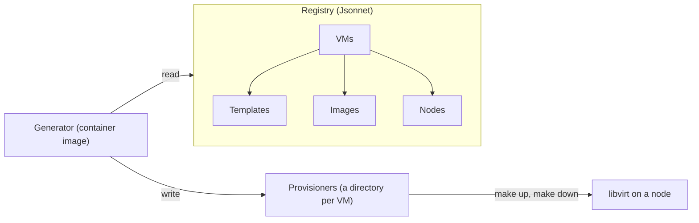

# virtgen

Keep the configurations of your libvirt VMs in one place, and create or delete any of them with one command.

**This project is in an early stage of development. Anything may change without notice.**

## Goals

virtgen is for keeping many VMs on libvirt, each created from its configuration and deleted when it is no longer needed:

- **Manage the configurations of many VMs in one place.** A registry holds every VM, and templates hold what VMs share, such as how to boot a cloud image. So the file of a VM says only what makes it different.
- **Create and delete VMs, and nothing more.** One command creates a VM, another waits until it is ready, and another deletes it. virtgen does not follow what happens to a VM in between.
- **Keep working for years.** virtgen depends only on libvirt, cloud-init and common commands, not on tools that have to keep up with them.

That is why virtgen generates provisioners instead of running VMs itself. A provisioner is a directory of plain files: libvirt XML, cloud-init files, and a Makefile that runs virsh. You can read it, and compare it with the last one, before you use it. It runs without virtgen, so it keeps working even if virtgen changes or goes away. virtgen keeps no state either: what exists is what libvirt reports.

The registry is written in Jsonnet, in the formats of libvirt and cloud-init themselves. So a VM can use whatever libvirt and cloud-init offer, without waiting for virtgen to support it.

virtgen treats a VM as disposable, and its configuration as changing only in the registry: to change a VM, you change the registry and create the VM again. A real VM can of course be changed in place, such as with virsh or virt-manager, but virtgen does not know about such changes. `make up` defines the domain again from the provisioner, and `make down` deletes only what the provisioner describes.

## Concepts



- **Registry:** the directory of Jsonnet files that defines all VMs. `vms/` has one file per VM. The other directories, such as `templates/`, `images/`, `nodes/` and `secrets/` in the example, are up to you.
- **VM:** a virtual machine, defined by its file in `vms/` as a composition of templates.
- **Template:** a reusable part of a VM, such as booting a cloud image, a data disk, or a remote display.
- **Image:** an OS image that a VM boots from: a cloud image, which cloud-init sets up, or a live image.
- **Node:** a host where libvirt runs VMs, as libvirt calls it. It has the URI that virsh connects to, and its default network and pool.
- **Generator:** the container image of virtgen. It renders the registry into provisioners and validates them.
- **Provisioner:** a directory for one VM with its libvirt XML, its cloud-init files, and a Makefile whose targets create, start, stop and delete the VM.
- **Lifecycle policy:** what becomes of a pool or a volume when its VM is deleted. A Disposable one goes with the VM. A Reusable one stays, and the VM uses it again when it is created again, until `make delete-all`. A Shared one, such as an image, stays for other VMs.

## Prerequisites

### Generating provisioners

- Podman, or Docker.

### Provisioning VMs

- A node: a host with libvirt and QEMU/KVM, and a user who may manage it, such as a member of the group `libvirt` on Debian. The example uses the local one, `qemu:///system`, with its network `default` and its pool `default` at `/var/lib/libvirt/images`, both active.
- OVMF on the node, for a VM that boots with UEFI, such as `debian13` of the example.
- On the machine that runs the provisioners: GNU Make, Bash, virsh, xorriso, curl, and ssh, plus sshpass for a VM that logs in with a password.

## Getting Started

Pull the generator, and get the example registry from this repository:

```console
$ podman pull ghcr.io/t13a/virtgen
$ git clone https://github.com/t13a/virtgen.git
$ cd virtgen/example
```

Render the registry into provisioners:

```console
$ podman run --rm --userns=keep-id -v ./registry:/src/registry -v ./provisioners:/src/provisioners ghcr.io/t13a/virtgen
```

Create a VM, log in to it, and delete it. The first `up` downloads the cloud image of Debian.

```console
$ make -C provisioners/debian13 up              # create and start the VM
$ make -C provisioners/debian13 wait-for-ready  # wait until SSH works and cloud-init has finished
$ make -C provisioners/debian13 ssh             # log in; CMD=uptime runs a command instead
$ make -C provisioners/debian13 down            # delete the VM; its image stays for other VMs
```

The VMs of the example log in with the password in `registry/secrets/`. To define your own VMs, copy the example registry and change it; the reference below describes its format.

## Reference

### Generator

The generator renders the registry in `registry/` into `provisioners/`. It also updates `registry/index.libsonnet`, which lists the files of the registry. It validates the files that differ from the last render, and replaces `provisioners/` only when they are valid.

```console
$ podman run --rm --userns=keep-id -v ./registry:/src/registry -v ./provisioners:/src/provisioners ghcr.io/t13a/virtgen
```

`config` prints the VMs as the generator sees them, with their templates merged. It needs only the registry.

```console
$ podman run --rm --userns=keep-id -v ./registry:/src/registry ghcr.io/t13a/virtgen config
```

With Docker, give `--user "$(id -u):$(id -g)"` instead of `--userns=keep-id`.

Each release publishes the image under its version, such as `0.1.0` for the tag `v0.1.0`, and as `latest`.

### Registry

A VM is an object whose visible sections mirror the formats of their readers:

| Section | Format |
|---|---|
| `domain`, `pools`, `volumes` | libvirt XML |
| `userData`, `metaData`, `networkConfig` | cloud-init NoCloud files |
| `ssh` | `user`, `host`, `password` and `options` for `make ssh` |

`ssh.options` are ssh_config options, given to ssh as `-o`; an array becomes a comma-separated list. When the provisioner reaches the node through a `qemu+ssh` URI, ssh reaches the VM through the host of the URI, unless the options set `ProxyJump`.

XML is written as objects:

- `'@attr'` is an attribute, and `'#text'` the text content.
- `'elem:key'` is an element `<elem>`. `:key` only names it, so that templates can merge into it.
- An array is a list of elements without names.

Hidden fields carry what the XML cannot hold:

| Where | Hidden fields |
|---|---|
| The VM | `name`, `node` (with `uri`), `seed` (the NoCloud ISO, relative to the directory of the VM) |
| `domain` | `autostart` (false by default) |
| A pool | `autostart` (false by default), `lifecyclePolicy` |
| A volume | `lifecyclePolicy`, `upload` (a file relative to the directory of the VM), `download` (the URL of that file) |

Any other hidden field inside a section must be null, which removes an element or a key that the VM inherits. So a misspelled field is an error instead of a silent default.

`lifecyclePolicy` is `Disposable` (the default), `Reusable`, or `Shared`, as described in [Concepts](#concepts).

Templates are mixins, as in `t.base + t.cloud(...) + { ... }`. A template that binds `local vm = self` sees the final VM, fully merged, so it can use what the VM sets later, such as its `name` and `node`.

A VM that logs in with a password has it in plain text in only two places, so that a repository can encrypt just those: `registry/secrets/` in the example, and the file `sshpass` of its provisioner. cloud-init gets the hash of the password, which `registry/secrets/` holds next to the password:

```console
$ openssl passwd -6  # asks for a password and prints its hash
```

### Provisioners

Run the targets with `make -C provisioners/<VM> <target>`:

| Target | What it does |
|---|---|
| `up` | Creates what is missing of the VM, defines its domain, and starts it. |
| `wait-for-ready` | Waits until SSH works and cloud-init has finished. |
| `ssh` | Logs in to the VM, or runs `CMD` on it, such as `CMD='uptime; df -h'`. `SSH_EXTRA_OPTS` gives ssh more options, such as `-v`, which win over those of the VM. |
| `console` | Attaches to the serial console of the VM. `Ctrl+]` detaches. |
| `stop` | Asks the guest to shut down, and waits up to `STOP_TIMEOUT` seconds, 300 by default. |
| `stop-force` | Cuts the power of the VM, so the guest may lose what it has not written to its disks. |
| `down` | Cuts the power, and deletes the VM except what is Reusable or Shared. |
| `delete-all` | Cuts the power, and deletes the VM except what is Shared. |
| `create-shared` | Creates only what is Shared, such as the images. |
| `download` | Downloads the images ahead of time. `up` downloads what it needs. |

The provisioner connects to the node by the URI of its node. To reach the node another way, such as from another machine, give the URI to make, and ssh reaches the VM through the host of a `qemu+ssh` URI too:

```console
$ make -C provisioners/debian13 up LIBVIRT_DEFAULT_URI=qemu+ssh://node.example/system
```

The environment variable `LIBVIRT_DEFAULT_URI` does not change it, so that a value set for something else cannot send a VM to another node.

To change a VM, change the registry and render it, then:

- `stop` and `up` apply a change to `domain.xml`, and the disks stay.
- `down` and `up` apply any other change. Run `stop` before `down` when a Reusable disk should keep all that the guest wrote.

To remove a VM, run `down` or `delete-all` before its file leaves the registry, because the next render has no provisioner for it. The same goes before a change that renames a pool or a volume.

To create VMs in parallel, first run `create-shared` for one VM at a time, so that no two VMs upload the same image at once.
